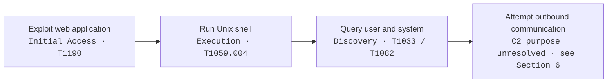
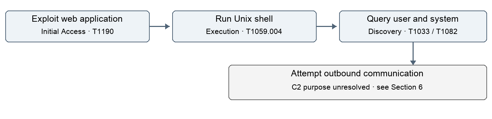
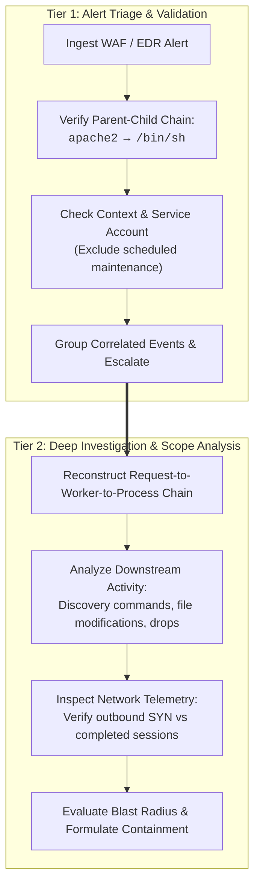

# PHP2Shell Attack Analysis
## Lab 1 | CTI Evidence, MITRE ATT&CK Mapping, and SOC Investigation

**Course:** AI-Enhanced Cybersecurity (HIT)  
**Author / Group Member:** Elizabetha Afonin  
**Submission Date:** 28 October 2026  
**Source Verification Date:** October 28, 2026  

---

## 1. Selected CTI Report

* **Primary CTI Source:** Adel Karimi (0x4D31). *“PHP2Shell exploitation observed: packet-to-process RCE evidence.”* Published in the public `honeypot-data` repository, 24 October 2026. Accessed 28 October 2026. [[1]](#7-references)
* **Direct Report URL:** [https://github.com/0x4D31/honeypot-data/blob/main/reports/php2shell/2026-10-24-confirmed-rce.md](https://github.com/0x4D31/honeypot-data/blob/main/reports/php2shell/2026-10-24-confirmed-rce.md)
* **Corroborating Vendor CTI Advisories:** Palo Alto Networks Unit 42 [[7]](#7-references), Google Cloud / Mandiant [[8]](#7-references), and Microsoft Security [[9]](#7-references).

> [!NOTE]
> **Scope & Methodological Boundary:**  
> This report analyzes published observational data from instrumented honeypots, cross-referenced with vendor threat advisories [[7–9]](#7-references). It does not claim that our group executed the exploit or independently validated the underlying raw packet captures. All MITRE ATT&CK classifications, confidence ratings, and proposed SOC operational workflows represent our own analytical evaluation.

---

## 2. Attack Summary

The selected report documents PHP2Shell activity against instrumented PHP honeypots observed on 24 October 2026. The vulnerable targets ran PHP 8.4.26 with Apache `mod_php`. Incoming HTTP requests triggered memory pressure and disclosure, followed by an execution request that resulted in remote shell invocation. The author links the observed exploitation chain to **CVE-2026-109618**; a separate CVE-2026-109619 exploitation path was not established. 

Runtime process evidence demonstrates an Apache worker process spawning `/bin/sh`, which was subsequently followed by host and identity discovery queries (`id`, `hostname`, `uname`). Outbound HTTP connection attempts were also logged. While these observations firmly substantiate initial access, execution, and local discovery, they do not demonstrate an established, persistent command-and-control (C2) channel or the compromise of an enterprise production environment. [[1]](#7-references)

The primary analytical objective for this laboratory is to map each empirically supported behavior to MITRE ATT&CK and determine the exact telemetry a Security Operations Center (SOC) requires before escalating an incident. We treat achieving remote code execution (RCE) as the verified outcome, while the adversary's ultimate objectives remain undetermined.

---

## 3. Attack Flow

*Figure 1. Analytical sequence based on honeypot case evidence [1]. Memory pressure and disclosure form the exploit stage. The final outbound branch represents an unconfirmed attempt rather than an established C2 channel.*

---

## 4. Evidence-Based MITRE ATT&CK Mapping

Four observable behaviors substantiated by empirical telemetry in the report are classified below. Evidence pointers refer to specific sections in [[1]](#7-references); definitions and tactic assignments align with official MITRE ATT&CK standards [[2–5]](#7-references).

| Observed Behavior | ATT&CK Tactic | Technique & ID | Evidence and Mapping Rationale | SOC Telemetry & Investigation |
| :--- | :--- | :--- | :--- | :--- |
| **HTTP exploitation** | Initial Access | **Exploit Public-Facing Application** [`T1190`](https://attack.mitre.org/techniques/T1190/) | **Evidence:** [1], *“Case evidence: HTTP request to Apache child process.”* Exploiting a network-exposed service to gain initial code execution directly satisfies T1190 [2]. **Confidence: High**. *Constraint:* Does not establish access beyond the targeted container/host. | Correlate incoming HTTP requests with PHP core memory errors and spawned child processes. Inspect web server version, loaded modules, and patch baseline. |
| **`/bin/sh` execution** | Execution | **Command and Scripting Interpreter: Unix Shell** [`T1059.004`](https://attack.mitre.org/techniques/T1059/004/) | **Evidence:** [1], *“Selected runtime records.”* A standard Unix command interpreter was invoked directly by the web server daemon [3]. **Confidence: High**. *Constraint:* Execution was in-memory via server worker; does not prove an on-disk web shell file. | Inspect full process tree, parent PID (`apache2`), command line arguments, execution context (UID 33 / `www-data`), and child spawns. Preserve memory and process timeline. |
| **`id` / `id -un`** | Discovery | **System Owner/User Discovery** [`T1033`](https://attack.mitre.org/techniques/T1033/) | **Evidence:** [1], *“Selected runtime records,”* identity query entries immediately following shell spawn. Querying system identity to determine execution context satisfies T1033 [4]. **Confidence: High**. *Constraint:* Benign in administrative contexts; suspicious due to process ancestry. | Review executing UID and arguments. Correlate with the exploit-spawned shell to determine whether the adversary escalated beyond low-privileged service account limits. |
| **`hostname` / `uname -m`** | Discovery | **System Information Discovery** [`T1082`](https://attack.mitre.org/techniques/T1082/) | **Evidence:** [1], *“Selected runtime records,”* host and kernel architecture queries. Enumerating OS and hardware architecture satisfies T1082 [5]. **Confidence: High**. *Constraint:* Local reconnaissance only; does not prove network scanning. | Examine execution logs and captured command standard output. Determine whether collected system information remained local or was transmitted outbound. |

> [!IMPORTANT]
> **Mapping Discipline:**  
> ATT&CK techniques identify observable adversary behaviors. They do not constitute proof of identity, malicious intent, persistence, or secondary lateral compromise. In accordance with MITRE mapping guidelines, speculative sub-techniques have been avoided where direct evidence is lacking (e.g., T1190, T1033, and T1082 remain at the parent technique level).

---

## 5. Proposed SOC Investigation Workflow

The operational investigation procedure below outlines how an enterprise SOC should detect, triage, and investigate similar PHP exploitation attempts:

### A. Exploitation of Exposed Web Application (T1190)
* **Telemetry Sources:** Reverse-proxy / WAF logs, Apache access and error logs, PHP error logs, network packet captures (PCAP), and application container configuration inventories.
* **Tier 1 (Triage):** Validate the alert timestamp against reverse-proxy access logs. Filter out known benign scanner probes that return standard 4xx/5xx responses without subsequent process activity. Verify whether the target host runs a vulnerable PHP version (e.g., unpatched PHP 8.4.x).
* **Tier 2 (Investigation):** Reconstruct the exact relationship between incoming HTTP request payloads, worker process memory crashes, and downstream process executions. Cross-correlate IP provenance across independent logs. Query enterprise telemetry across all web assets to identify whether the same attack signature targeted other systems.

### B. Unexpected Shell Execution (T1059.004)
* **Telemetry Sources:** EDR, Linux `auditd`, or Tetragon (eBPF) process execution telemetry containing executable paths, parent PIDs, UID/GID, full command line strings, container namespaces, and exit codes.
* **Tier 1 (Triage):** Inspect the complete process hierarchy. Confirm whether `apache2` or `php-fpm` legitimately spawns `/bin/sh` in the environment (almost universally an indicator of compromise). Do not close alerts merely because the process executed as a low-privileged user (`www-data`).
* **Tier 2 (Investigation):** Trace all descendant processes spawned by `/bin/sh`. Check for created temporary files or dropped payloads in `/tmp`, `/dev/shm`, or web directories. Coordinate containment actions (e.g., container isolation, web service restart) with the incident commander while preserving volatile memory.

### C. System and User Discovery (T1033 & T1082)
* **Telemetry Sources:** Process execution streams, shell history, standard output capture (where EDR/eBPF supports it), and correlated network socket events.
* **Tier 1 (Triage):** Group discovery commands (`id`, `hostname`, `uname`) executing within seconds of the shell spawn into a single consolidated incident. Verify that these were not invoked by standard administrative cron jobs.
* **Tier 2 (Investigation):** Evaluate whether discovery command outputs were piped into files or outbound network streams. Distinguish passive local reconnaissance from active privilege escalation attempts.

### Evidence Handling and Decision Record
* Preserve raw log records with verified UTC timestamps.
* Hash all exported evidence files (SHA-256) to maintain chain-of-custody.
* Clearly delineate confirmed facts from working hypotheses in ticket documentation.

---

## 6. Uncertain Mapping and Alternative Interpretation

### Candidate: Command and Control via Web Protocols (`T1071.001`)

* **Unresolved Analytical Question:** Does the observed outbound HTTP connection attempt warrant mapping to **T1071.001 (Application Layer Protocol: Web Protocols)** under the **Command and Control** tactic? [[6]](#7-references)
* **Why it was withheld:** An HTTP connection attempt alone demonstrates transport capability, but does not prove the existence of an established bidirectional command-and-control channel.
* **Alternative Explanations:**
  1. *Execution-verification callback (Canary):* The adversary may have executed a single non-interactive request (e.g., via `curl`) simply to confirm external reachability or notify a webhook that exploitation succeeded.
  2. *Failed egress connection:* Honeypot telemetry indicates that network egress was restricted (e.g., `TCP_SYN_SENT` without response), meaning no two-way data transmission or payload staging ever occurred.

### Evidence Required to Resolve

To conclusively map this behavior to T1071.001 or confirm an alternative hypothesis, a SOC analyst would require:
1. **Full application-layer packet capture (PCAP) or TLS proxy logs:** Capturing completed HTTP request and response headers/bodies to verify whether commands, tasking instructions, or payloads were exchanged.
2. **Endpoint process-socket correlation:** Confirming that the outbound network socket was owned by the spawned shell or a known secondary payload.
3. **Subsequent interactive activity:** Observing subsequent commands executed as a direct result of incoming server responses.

### Review Question & Discussion Record
> *“What specific operational evidence distinguishes a one-way exploit verification callback from an interactive Command and Control channel?”*  

* **Discussion Date & Participants:** 28 October 2026 — Elizabetha Afonin, reviewed with instructor / peer group.
* **Consensus & Conclusion:** Confirmed that an isolated outbound HTTP request (e.g., via `curl` or single beacon) without evidence of inbound tasking or an ongoing command loop cannot be reliably mapped to `T1071.001` (Command and Control). To maintain evidence-based rigor and avoid unwarranted escalation, the technique remains categorized as an unresolved candidate until bidirectional payload exchange or persistent egress beaconing is corroborated by network telemetry.

---

## 7. References

* **[1]** Karimi, A. (0x4D31). *PHP2Shell exploitation observed: packet-to-process RCE evidence*. Public honeypot-data repository (24 Oct 2026). [GitHub Report Link](https://github.com/0x4D31/honeypot-data/blob/main/reports/php2shell/2026-10-24-confirmed-rce.md)
* **[2]** MITRE ATT&CK. *T1190 — Exploit Public-Facing Application*. [https://attack.mitre.org/techniques/T1190/](https://attack.mitre.org/techniques/T1190/)
* **[3]** MITRE ATT&CK. *T1059.004 — Command and Scripting Interpreter: Unix Shell*. [https://attack.mitre.org/techniques/T1059/004/](https://attack.mitre.org/techniques/T1059/004/)
* **[4]** MITRE ATT&CK. *T1033 — System Owner/User Discovery*. [https://attack.mitre.org/techniques/T1033/](https://attack.mitre.org/techniques/T1033/)
* **[5]** MITRE ATT&CK. *T1082 — System Information Discovery*. [https://attack.mitre.org/techniques/T1082/](https://attack.mitre.org/techniques/T1082/)
* **[6]** MITRE ATT&CK. *T1071.001 — Application Layer Protocol: Web Protocols*. [https://attack.mitre.org/techniques/T1071/001/](https://attack.mitre.org/techniques/T1071/001/)
* **[7]** Palo Alto Networks Unit 42. *Threat Brief: Critical Vulnerabilities in PHP (CVE-2026-109618, CVE-2026-109619)* (23–25 Oct 2026). [https://unit42.paloaltonetworks.com/cve-2026-109618-cve-2026-109619/](https://unit42.paloaltonetworks.com/cve-2026-109618-cve-2026-109619/)
* **[8]** Google Cloud / Mandiant. *Responding to core PHP vulnerabilities CVE-2026-109618 and CVE-2026-109619* (21–23 Oct 2026). [https://cloud.google.com/blog/products/identity-security/responding-to-core-php-vulnerabilities-cve-2026-109618-cve-2026-109619](https://cloud.google.com/blog/products/identity-security/responding-to-core-php-vulnerabilities-cve-2026-109618-cve-2026-109619)
* **[9]** Microsoft Security. *Addressing PHP2Shell CVE-2026-109618 and CVE-2026-109619: upgrade guidance and Azure WAF mitigations* (21–26 Oct 2026). [https://techcommunity.microsoft.com/blog/azurenetworksecurityblog/addressing-php2shell-cve-2026-109618-and-cve-2026-109619-upgrade-guidance-and-az/4566623](https://techcommunity.microsoft.com/blog/azurenetworksecurityblog/addressing-php2shell-cve-2026-109618-and-cve-2026-109619-upgrade-guidance-and-az/4566623)
